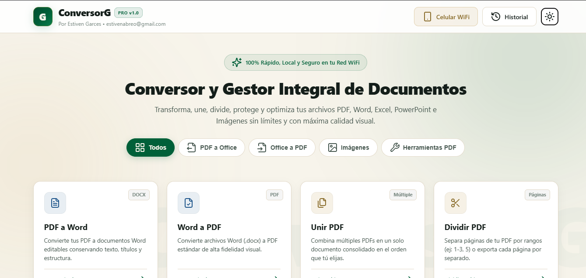
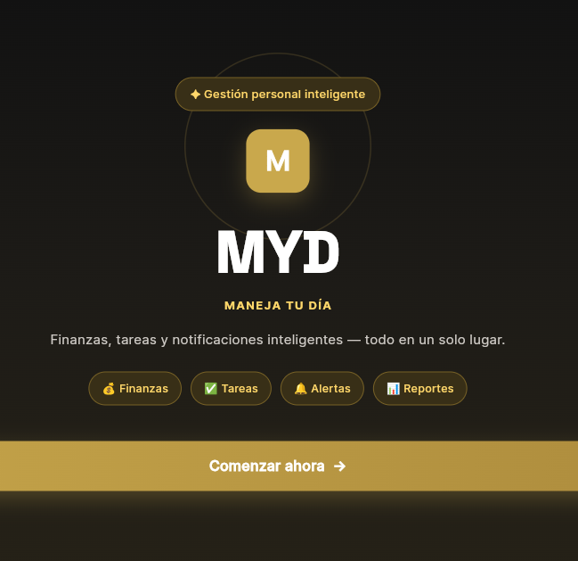
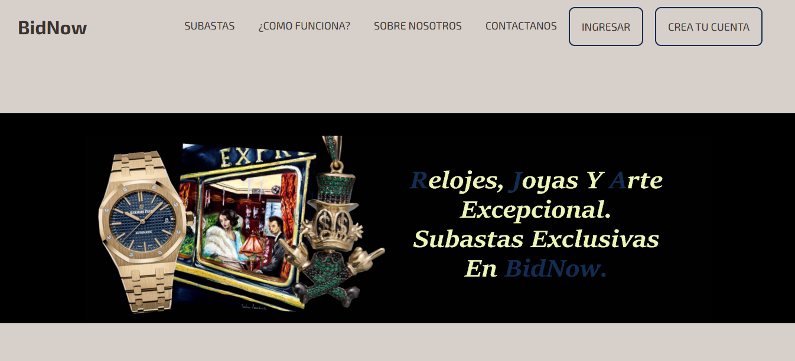
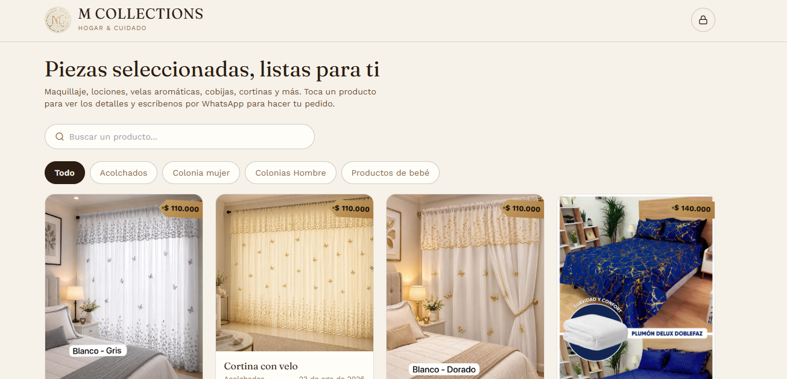

# Estiven Garcés | Portafolio personal

**Portafolio web personal donde presento mi formación, experiencia y proyectos de software.**

[Ver portafolio](https://estiveng1.github.io/Mi-Portafolio/) · [Mi GitHub](https://github.com/EstivenG1) · [Contáctame](mailto:estivenabreo@gmail.com)

---

## Sobre mí

Soy **Estiven Garcés Abreo**, Bachiller, Técnico en Programación de Software y Tecnólogo en Análisis y Desarrollo de Software en formación.

Me caracterizo por el compromiso, la responsabilidad y una comunicación clara. Disfruto construir soluciones útiles, aprender nuevas tecnologías y adaptarme a distintos retos de desarrollo. Mi objetivo profesional es seguir creciendo dentro del sector tecnológico y contribuir a equipos que generen productos funcionales y bien diseñados.

## Presentación del proyecto

Este portafolio fue desarrollado con HTML, CSS y JavaScript. Presenta una identidad visual elegante basada en una paleta de tonos blanco hueso, negro y dorado, con una navegación adaptable, tarjetas de proyectos y vistas previas interactivas.

El sitio está diseñado para verse correctamente en escritorio y dispositivos móviles.

## Proyectos destacados

| Proyecto | Descripción | Tecnologías |
| :--- | :--- | :--- |
| **ConversorG** | Suite para convertir, unir, dividir y optimizar documentos de forma local. | JavaScript, Node.js, C# / .NET |
| **MYD** | Aplicación para organizar tareas, notas, finanzas personales, presupuestos y metas. | Web, Android |
| **BidNow** | Plataforma colaborativa de subastas para publicar productos y participar en pujas. | PHP, JavaScript, CSS |
| **M Collections** | Catálogo digital de hogar y cuidado con acceso a pedidos por WhatsApp. | HTML, JavaScript, Tailwind CSS |

### ConversorG

- Herramientas para PDF y documentos
- Conversión PDF a Word
- Unión y división de archivos
- Interfaz adaptable

[Ver repositorio](https://github.com/EstivenG1/ConversorPdf)

### MYD · Manage Your Day

- Gestión de tareas y notas
- Organización de finanzas personales
- Control de presupuestos y ahorros
- Aplicación web y versión Android

[Ver repositorio](https://github.com/EstivenG1/ManajeYourDay) · [Abrir demo](https://estiveng1.github.io/ManajeYourDay/)

### BidNow

- Publicación de productos
- Participación en subastas
- Plataforma desarrollada de manera colaborativa

[Ver repositorio](https://github.com/EstivenG1/BidnowGG)

### M Collections

- Catálogo de productos de hogar y cuidado
- Visualización por categorías
- Pedidos directos por WhatsApp

[Ver repositorio](https://github.com/EstivenG1/m-collections)

## Tecnologías utilizadas

- **HTML5** — estructura semántica
- **CSS3** — diseño, animaciones y responsive design
- **JavaScript** — navegación y ventanas de vista previa
- **Git y GitHub** — control de versiones
- **GitHub Pages** — publicación del sitio

## Contacto

- **Correo:** [estivenabreo@gmail.com](mailto:estivenabreo@gmail.com)
- **GitHub:** [EstivenG1](https://github.com/EstivenG1)
- **Ubicación:** Colombia

---

**Diseñado y desarrollado por Estiven Garcés · 2026**

